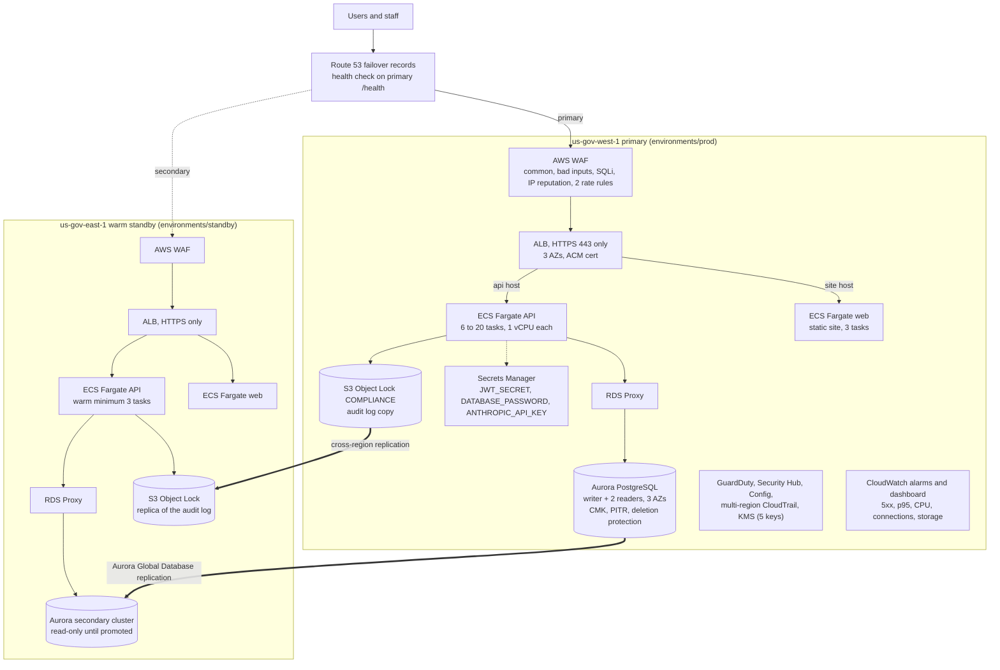

Written and statically checked; not applied.

# AWS GovCloud infrastructure as code (STORY-004)

**Not applied. Waiting on approval.** Nothing in this folder has been planned or applied. No AWS credentials were configured and no AWS API was called while writing or checking it. The checks that were run are static (format, schema validation, lint, a security scan) and are listed in section 8 with their output under `checks/`.

This is the production design of `sss-modernization-demo/docs/FAILOVER.md` and the sizing of `sss-modernization-demo/docs/PRODUCTION-SIZING.md`, written as Terraform for the AWS GovCloud (US) partition, ready for Ram's review. The demo itself runs on Render and stays there until this is approved and applied.

## 1. What it builds

Terraform `>= 1.9`, AWS provider pinned exactly to `5.100.0` (lock files are committed). Two independent roots, one per region, sharing five modules.

```
infrastructure/aws-govcloud/
  modules/
    network/        VPC, 3 AZ x (public, private-app, private-data), NAT per AZ, flow logs, endpoints, task security group
    security/       KMS keys, GuardDuty, Security Hub, CloudTrail, AWS Config, WAF, S3 access-log bucket
    data/           Aurora PostgreSQL (global), RDS Proxy, Secrets Manager (3 secrets), Object Lock audit bucket
    compute/        ALB (HTTPS only), ECS Fargate (API + static site), ECR, autoscaling, task and execution roles
    observability/  SNS alarm topic, CloudWatch alarms mirroring the SLOs, dashboard
  environments/
    prod/           us-gov-west-1, primary (also the Route 53 failover records)
    standby/        us-gov-east-1, warm standby
  checks/           saved output of the static checks and the script that produced it
```



### How it maps to FAILOVER.md

| FAILOVER.md layer | In this code |
|---|---|
| DNS: Route 53 failover records, health checks on `/health`, 30 s, 3 failures | `environments/prod/dns.tf`: HTTPS_STR_MATCH health check on the primary ALB for `"database":"ok"`, interval 30, failure threshold 3; PRIMARY and SECONDARY alias records for the API and site hosts. Off until `manage_dns = true`. |
| Edge: WAF and an ALB per region across three AZs | `modules/security/waf.tf`, `modules/compute/alb.tf`; both roots. |
| API: ECS Fargate, at least 2 tasks per zone in the primary, scaled on CPU and request count, warm minimum in the secondary | `modules/compute/ecs.tf`: minimum 6 (2 per zone), desired 10, maximum 20, target tracking on CPU (50%) and ALB requests per target; standby minimum 3. |
| Database: Aurora Global Database, Multi-AZ writer, read-only secondary cluster in the other region | `modules/data/db.tf`: `aws_rds_global_cluster` plus a primary cluster with 3 instances across 3 AZs; the standby root joins as a secondary cluster. |
| Secrets and keys in both regions | `modules/data/secrets.tf`, `modules/security/kms.tf` in both roots. |
| Files: S3 with cross-region replication and Object Lock for the audit copy | `modules/data/audit.tf`: Object Lock COMPLIANCE bucket in each region; replication from primary to standby (second apply). |
| Observability: CloudWatch in each region, SLO alerts | `modules/observability`: alarms below; each root has its own. |
| RTO under 15 min (region), 2 min (zone); RPO under 1 min (replication), 5 min (backups) | Zone loss: ALB, Fargate across 3 AZs, Aurora Multi-AZ failover. Region loss: Route 53 failover plus the manual promotion in section 7. Backups retained 35 days with point-in-time recovery. These are design targets; no game day has been run. |

### How it maps to PRODUCTION-SIZING.md

| Sizing | In this code (variable) |
|---|---|
| 8 to 10 one-vCPU processes, about 9 vCPUs, 1 GB per vCPU ample | `api_cpu = 1024`, `api_memory = 2048` (the Fargate minimum for 1 vCPU), `api_desired_count = 10` |
| Spread across at least 2 AZs, lose a zone without tipping over | 3 AZs, minimum 6 tasks, CPU target 50% |
| `UV_THREADPOOL_SIZE` set to the vCPUs | set to `max(vCPUs, 4)` (never below Node's default of 4) |
| A pooler; 10 processes x 8 connections | RDS Proxy (transaction pooling), `DATABASE_POOL_MAX = 8` |
| Writer 4 vCPU plus a read replica for the heavy dashboards, Multi-AZ | `db.r6g.xlarge`, `db_instance_count = 3` (writer, failover reader, dashboard reader), plus a read-only proxy endpoint `proxy_read_only_endpoint` |
| 37 GB a day of audit rows | Aurora storage grows automatically; the Object Lock bucket takes the append-only copy. Partitioning `audit_logs` by month is still an application task. |
| Rate limits and a firewall in front, sized from the 20% sign-in assumption | WAF general rate rule (3,000 per IP per 5 minutes) and a tighter sign-in rule (100 per IP per 5 minutes on `/api/auth/`); both variables |

The sizing document calls `db.r6g.xlarge` "4 vCPU and 16 GB". The instance class has 4 vCPU and 32 GiB; the code uses the class name and the sizing text should be corrected.

### The three secrets and the other variables

`JWT_SECRET`, `DATABASE_PASSWORD` and `ANTHROPIC_API_KEY` are Secrets Manager secrets, encrypted with the secrets key. Terraform creates each with the obvious placeholder `PLACEHOLDER-SET-BY-OPERATOR` and ignores later changes, so Terraform never reads, holds or overwrites the real value. The Aurora master password is generated and kept by RDS (`manage_master_user_password`), so it is never in code or in state. `DATABASE_PASSWORD` is stored as JSON (`{"username":"sss_app","password":"..."}`) so RDS Proxy can authenticate with the same secret; the task reads its `password` and `username` keys.

Non-secret names follow `OPERATOR-RUNBOOK.md` section 8: `NODE_ENV`, `PORT`, `DATABASE_HOST` (the proxy), `DATABASE_PORT`, `DATABASE_NAME`, `DATABASE_SSL=true`, `DATABASE_POOL_MAX`, `CORS_ORIGIN` (the site host), `OTEL_SERVICE_NAME`. Everything else (`ADMIN_EMAILS`, `AI_*`, `OTEL_EXPORTER_OTLP_ENDPOINT`) goes in `extra_environment`.

### Alarms (mirroring the app's objectives)

| Alarm | Signal | Threshold |
|---|---|---|
| 5xx rate | `HTTPCode_Target_5XX_Count / RequestCount` (metric math) | over 0.5% for 3 of 5 minutes (availability objective 99.5%) |
| ALB's own 5xx | `HTTPCode_ELB_5XX_Count` | over 10 per minute, 3 of 5 |
| p95 latency | `TargetResponseTime` p95 | over 2 s, 3 of 5 (latency objective) |
| Unhealthy tasks | `UnHealthyHostCount` | over 0 for 3 minutes |
| ECS CPU / memory | `AWS/ECS` average | over 80% |
| Running tasks | Container Insights `RunningTaskCount` | under the autoscaling minimum |
| DB CPU, connections, free local storage, replica lag | `AWS/RDS` per instance | 80%, 500 connections, 10 GB, 5 s |

All alarms publish to one KMS-encrypted SNS topic; email subscriptions come from `alarm_emails` and must be confirmed by each recipient.

## 2. GovCloud-specific constraints found

These were checked against the AWS GovCloud (US) User Guide where a page was available (Route 53 page read on 2026-10-27) and otherwise come from the service behaviour as documented; each item marked "verify" must be confirmed in the real account before apply.

1. **CloudFront is not available in the GovCloud partition, so "S3 plus CloudFront" for the static site is not the option.** Decision: **the static site is a second ECS Fargate service (the existing `frontend` image, `serve -s dist`, port 5173) behind the same ALB**, routed by host name (`app_hostname` to the web service, `api_hostname` to the API). An ALB cannot target an S3 bucket directly; S3 website endpoints are HTTP only and public, which fails the "HTTPS only" criterion; putting S3 behind the ALB through VPC endpoint IP targets works but is fragile. Fronting the site with CloudFront from a linked commercial account would move traffic outside the GovCloud boundary and was not done. The cost is some Fargate hours instead of S3 and no edge caching; response compression and caching headers belong in the web container.
2. **ARNs use the `aws-us-gov` partition.** The code reads the partition from `aws_partition` and validates the certificate ARN; nothing hard-codes `aws`.
3. **Route 53.** Public hosted zones, alias records to ALBs and health checks are supported in GovCloud. Alias targets must be inside GovCloud, health checkers reach the endpoint over the public internet (the ALB is public), the control plane is in `us-gov-west-1` (so changing DNS by hand during a west outage depends on the control plane; health-check driven failover does not), and domain registration is not available (register or delegate the domain elsewhere and point it at the hosted zone).
4. **Account model.** GovCloud accounts are created from, and linked to, a commercial AWS account by a U.S. person; the GovCloud root user and credentials are separate. Terraform runs with a role in the GovCloud account (runbook prerequisites).
5. **IAM is partition-wide, not regional.** Role names are unique per root through the name prefix (`sss-prod`, `sss-prod-standby`) and a region suffix on the few that would collide.
6. **Load balancer access logs.** The delivery principal is the regional ELB service account (`aws_elb_service_account`), not the newer service principal; the log bucket must use SSE-S3 because the ELB cannot write to a CMK-encrypted bucket. Verify the data source returns an account for both regions.
7. **Services with partial availability (verify before apply):** Aurora Global Database between the two GovCloud regions for the chosen engine version (`db_engine_version`); RDS Proxy for the chosen version; GuardDuty protection plans (`guardduty_features`); Security Hub standards (`securityhub_standards`, NIST SP 800-53 Rev 5 and AWS Foundational); Container Insights; Fargate on ARM (the code defaults to X86_64). Variables make each one a one-line change.
8. **FIPS.** The code does not set `use_fips_endpoint`. If the agency requires FIPS 140 endpoints for API calls, set it on the provider, and check the ALB TLS policy (`alb_ssl_policy`) against the FIPS policies offered.
9. **Encryption in transit stops at the ALB for the API and site.** ALB to task is HTTP inside the VPC (security groups allow only the ALB). End-to-end TLS needs the application to serve TLS; recorded as an open item.
10. **Prices** in GovCloud are higher than commercial regions (section 5).

## 3. Application changes this infrastructure needs (not made here)

This folder only adds infrastructure. These items in `sss-modernization-demo/` need a change by the application engineers before a production launch:

- **Production mode is keyed to Render.** The runbook says the presence of the `RENDER` variable switches on production-only behaviour: refusing to start without `JWT_SECRET` and reading the visitor's address from the proxy header. On AWS the API sits behind an ALB, which sets `X-Forwarded-For`, so those behaviours need a platform-neutral switch (for example `TRUST_PROXY` and `REQUIRE_JWT_SECRET`). Setting `RENDER=1` through `extra_environment` would work as a stopgap but is a hack; this code does not set it.
- **The Object Lock audit copy has no writer yet.** The bucket, the task-role permission (`s3:PutObject` only: no read, no delete) and the `AUDIT_ARCHIVE_BUCKET` variable exist; the application code that appends audit rows to the bucket (the open item of STORY-010) does not.
- **The static site image** must be built with the API address of the target environment (the frontend reads it at build time, `src/services/api.js`).

## 4. Variables worth reviewing first

| Variable | Default | Why it matters |
|---|---|---|
| `certificate_arn`, `app_hostname`, `api_hostname` | none | Required. The certificate must cover both host names, in each region. |
| `owner`, `data_classification` | none / `PII` | Tags on every resource (with `Project`, `Environment`, `ManagedBy`, `Role`) through provider `default_tags`. |
| `api_desired_count`, `api_min_count`, `api_max_count` | 10 / 6 / 20 | Sizing doc. First apply uses 0 and 0 (runbook). |
| `audit_retention_days` | 365 | **Object Lock COMPLIANCE cannot be shortened or removed, even by root.** Agree the retention schedule before the first object is written. |
| `db_deletion_protection` | true | Leave true. |
| `alb_ingress_cidrs` | `0.0.0.0/0` | Narrow it if the service is not public; Route 53 health checkers need the ranges in the AWS GovCloud Route 53 documentation. |
| `waf_rate_limit`, `waf_auth_rate_limit` | 3,000 / 100 per 5 min per IP | Shared agency egress addresses may need higher values. |

## 5. Estimated monthly cost

**This is an estimate, not a quote.** Prepared 2026-10-27 from the public list prices as I know them, not from a live GovCloud price list. GovCloud prices differ from commercial regions; I assumed a premium of about 20 to 30% over commercial list prices where I could not recall the GovCloud figure. Treat each line as plus or minus 40%, and replace it with the AWS Pricing Calculator for GovCloud before anything is committed. It excludes support plans, taxes, Savings Plans or Reserved Instance discounts (which could reduce Fargate and Aurora by 20 to 40%), and one-time costs.

Assumptions: 10,000 concurrent users at the peak but an average of about 100 requests per second over a month (260 million requests); 10 API tasks running all month; 2 TB of Aurora data after the first months; 1 TB of NAT data processing; 1 TB of data transfer out; about 200 GB of log ingestion a month; the audit copy growing by about 1 TB a month in S3 (37 GB a day) with the steady-state average shown; Aurora I/O billed per request (Aurora I/O-Optimized may be cheaper at this volume and is worth pricing).

| Component | Primary (west) | Standby (east, warm) | Basis |
|---|---|---|---|
| ECS Fargate (API 10 x 1 vCPU / 2 GB, web 3 x 0.25 vCPU / 0.5 GB; standby 3 + 3) | $485 | $170 | about $0.051 per vCPU-hour, $0.0056 per GB-hour |
| Aurora instances (3 x db.r6g.xlarge; standby 1) | $1,360 | $455 | about $0.62 per instance-hour |
| Aurora storage, I/O, backups | $840 | $270 | $0.12 per GB-month on 2 TB, I/O about $500, backup beyond the database size |
| Performance Insights (31 days) and enhanced monitoring | $65 | $22 | per vCPU |
| RDS Proxy | $160 | $55 | per instance vCPU-hour |
| NAT gateways (3 per region) and data processing | $170 | $125 | $0.054 per hour each plus per-GB |
| Interface VPC endpoints (4 services x 3 AZs) | $115 | $115 | per endpoint-hour plus per-GB |
| Application Load Balancer | $60 | $25 | hourly plus load units |
| AWS WAF (ACL, 6 rules, 260 M requests) | $170 | $15 | $5 + $1 per rule + $0.60 per million requests |
| CloudWatch (logs, metrics, alarms, Container Insights, dashboard) | $210 | $60 | ingestion and storage |
| GuardDuty | $200 | $30 | volume based |
| Security Hub | $40 | $20 | per check |
| AWS Config | $70 | $30 | per configuration item |
| CloudTrail (one management trail free; S3 and CloudWatch delivery) | $5 | 0 | |
| S3 (audit log copy, access and service logs, replica) | $150 | $110 | $0.04 per GB; moves to Glacier Instant Retrieval after 90 days |
| KMS (5 keys), Secrets Manager, ECR | $25 | $25 | per key, per secret, per GB |
| Route 53 (zone, health check) | $5 | 0 | |
| Data transfer out and Aurora cross-region replication | $190 | included | |
| **Total (rounded)** | **about $4,300** | **about $1,550** | **about $5,850 a month for both regions** |

The largest lines are Aurora (about half) and Fargate. The audit table and its S3 copy (37 GB a day) are the fastest-growing cost and depend on the retention schedule and on partitioning the table. The standby's cost buys the 15-minute region-loss objective; dropping it (a single region) saves about $1,550 a month and removes the region-failover claim.

## 6. APPLY RUNBOOK for Ram

> **Not applied. Waiting on approval.** Do not run any of this until Ram has approved the design and the monthly cost. Every command below is a plan for the person applying, not something that has been run. Rehearse in a non-production GovCloud account first.

### 6.1 Prerequisites

1. **A GovCloud (US) account** linked to the agency's or Colaberry's commercial account (AWS creates GovCloud accounts through a commercial account; a U.S. person must be the account holder). Enable the regions `us-gov-west-1` and `us-gov-east-1`.
2. **An IAM role for Terraform** in the GovCloud account (not an IAM user with long-lived keys): trust the operator's identity provider or a named person, permissions for the services in this code (EC2/VPC, ECS, ECR, ELB, WAF, RDS, KMS, Secrets Manager, S3, IAM role and policy management, CloudWatch, SNS, GuardDuty, Security Hub, CloudTrail, Config, Route 53, Application Auto Scaling). Start from PowerUser plus IAM role management and tighten after the first plan. Use it through a profile or SSO session, never a key in this repository.
3. **A state bucket and lock table, created by hand once** (they are deliberately not in this code, so a bad apply cannot delete the state): an S3 bucket in `us-gov-west-1` with versioning, default KMS encryption (a key you create for it), a bucket policy denying non-TLS access, and public access blocked; a DynamoDB table with partition key `LockID` (string). Keep a copy of the state bucket in `us-gov-east-1` (replication) so state survives a west outage.
4. **Certificates:** request an ACM public certificate in each region covering `app_hostname` and `api_hostname`, validate it by DNS, and note the ARNs (`arn:aws-us-gov:acm:...`). Confirm ACM public certificates are offered in your GovCloud account.
5. **DNS:** create the public hosted zone in Route 53 (GovCloud) for the domain and delegate the domain to its name servers (the domain itself cannot be registered in GovCloud). Note the zone ID.
6. **Tools:** Terraform 1.9.8 or later in the 1.x line, the AWS CLI, Docker.
7. **Decisions:** the audit retention (`audit_retention_days`), the alarm email addresses, the owner tag, the data classification label, the two host names.

### 6.2 Steps

Work in `infrastructure/aws-govcloud/environments/prod` first. Replace each placeholder in the example files with your own values in files that are **not** committed (`backend.hcl`, `terraform.tfvars`; both are git-ignored).

1. **Configure the backend and variables.**
   `cp backend.hcl.example backend.hcl` and `cp terraform.tfvars.example terraform.tfvars`, then edit both. Keep `api_desired_count = 0` and `api_min_count = 0` for now.
2. **Initialise.** `terraform init -backend-config=backend.hcl`. This downloads the provider pinned in `.terraform.lock.hcl`.
3. **Plan the whole stack and read it.** `terraform plan -out=plan.tfplan`. Review the plan with Ram: a few hundred resources, no destroys. Check the account ID and the region in the plan header.
4. **Apply in module order** (each stage is small enough to review; `-target` is used only for this first build, and step 5 reconciles):
   1. `terraform apply -target=module.security` (KMS, GuardDuty, Config, Security Hub, CloudTrail, WAF).
   2. `terraform apply -target=module.network`.
   3. `terraform apply -target=module.data` (Aurora takes about 20 to 30 minutes; the global cluster is created here).
   4. `terraform apply -target=module.compute` (ALB, ECS with zero tasks, ECR).
   5. `terraform apply -target=module.observability`.
5. **Reconcile.** `terraform plan` should now show no changes except nothing or minor drift; `terraform apply` once more with no `-target`.
6. **Confirm the alarm subscriptions.** Each address in `alarm_emails` gets a confirmation email from SNS; the alarms deliver only after it is confirmed.
7. **Set the three secrets** (this is the operator's step; the values never go in code, in chat or in a ticket):
   - `JWT_SECRET`: a new random value of at least 48 bytes. `aws secretsmanager put-secret-value --secret-id sss-prod/jwt-secret --secret-string "$(openssl rand -base64 48)"`. The standby must hold the **same** value or sign-ins issued by one region fail in the other.
   - `ANTHROPIC_API_KEY`: the key from the Anthropic console (or leave the placeholder and set `AI_PROVIDER=off` through `extra_environment` to run without the assistant).
   - `DATABASE_PASSWORD`: generate a password, create the database role (next step) and store `{"username":"sss_app","password":"<value>"}` as the secret string.
8. **Create the application database role.** From a task inside the VPC (the database has no public address): temporarily set `enable_execute_command = true` through a variable change and apply, start one task, use ECS Exec to run a short Node script with the `pg` package using the master credentials from the RDS-managed secret (output `master_secret_arn`), and execute `CREATE ROLE sss_app LOGIN PASSWORD '...'; GRANT ALL ON DATABASE sss TO sss_app; GRANT ALL ON SCHEMA public TO sss_app;`. Then turn Exec off again. (A bastion host or SSM port forward is an alternative; none is created by this code. Rehearse this step; it is the least automated part.)
9. **Push the images.** Authenticate Docker to the ECR repositories in the `ecr_repository_urls` output and push the API image (`sss-modernization-demo/backend`) and the web image (`sss-modernization-demo/frontend`, built with the API address of this environment), tagged with the git commit. Tags are immutable. Set `api_image_tag` and `web_image_tag` to those tags.
10. **Start the tasks.** Set `api_desired_count = 10`, `api_min_count = 6` (the defaults; delete the two zero lines) and `terraform apply`. ECS starts the tasks; the first start runs the migrations (`runMigrations()`); the API opens its port only after they finish. Watch `/health` through the load balancer's DNS name (`curl -H "Host: ..." https://<alb_dns_name>/health` should show `"database":"ok"`).
11. **Build the standby.** In `environments/standby`: copy the two example files, set `global_cluster_identifier` to the primary's output, set the same host names and the same `JWT_SECRET` value, `terraform init -backend-config=backend.hcl`, plan, apply in the same module order (the data stage creates the read-only secondary and takes 20 to 30 minutes), push the images to the standby ECR, and set `api_desired_count = 3`.
12. **Turn on cross-region audit replication.** In the primary set `audit_replica_bucket_arn` and `audit_replica_kms_key_arn` from the standby outputs and apply. Leave `manage_dns = false` until step 14: setting it creates the live records.
13. **Verify end to end.** Run `API_URL=https://<api host> SITE_URL=https://<app host> node scripts/verify-deploy.mjs` (the same script the Render deploys use); run the load harness from `scripts/load` against the new stack and replace the derived rows of `PRODUCTION-SIZING.md` with measured ones.
14. **Cut over DNS.** Lower the TTL of the current records a day ahead; set `hosted_zone_id`, `standby_alb_dns_name`, `standby_alb_zone_id` and `manage_dns = true` in the primary and apply (this creates the health check and the PRIMARY and SECONDARY failover records, which take the host names over), and delegate the domain to the Route 53 zone if it is not yet; watch the alarms and the Observability page for the first hour. Keep Render running until the new stack has served a full business day.
15. **Rehearse failover** before go-live (the game day of `FAILOVER.md`): stop the primary tasks, confirm Route 53 shifts, then follow section 7.

### 6.3 Rollback

- **A bad release:** ECS rolls back by itself (circuit breaker). By hand, set `api_image_tag` back to the previous commit and apply, or `aws ecs update-service --task-definition <previous revision>`. Migrations are forward-only (see `OPERATOR-RUNBOOK.md`); code rolls back, the schema does not.
- **A bad Terraform change:** revert the commit and apply, or restore the previous state version from the versioned state bucket. Never `terraform destroy` to undo a change.
- **Bad data:** restore with point-in-time recovery into a **new** cluster (`aws rds restore-db-cluster-to-point-in-time`), check it, then repoint `DATABASE_HOST` (the proxy target) or swap the cluster. The global cluster is not modified by a restore.
- **The whole cut-over:** set the DNS back to the Render addresses (the old records), which were kept running.

### 6.4 Teardown

1. Scale to zero (`api_min_count = 0`, `api_desired_count = 0`; for the web service add `web_desired_count = 0` to the `compute` module call) and apply.
2. Set `db_deletion_protection = false` and, in the `compute` module call in `main.tf`, `alb_deletion_protection = false`, and apply.
3. Detach the secondary cluster from the global cluster, destroy `environments/standby`, then `environments/prod`. A final snapshot is taken (`sss-prod-aurora-final`); delete it by hand when it is no longer needed.
4. **The audit bucket cannot be emptied or deleted until every object's COMPLIANCE retention has ended.** That is its purpose. `terraform destroy` will fail on it; leave it, or wait for the retention to end. Do not try to remove the Object Lock configuration (it is not possible).
5. KMS keys are scheduled for deletion with a 30-day window; Secrets Manager secrets have a 30-day recovery window.
6. Remove the state bucket and lock table last, by hand.

## 7. Region failover (manual part)

The pieces are in place; the order of operations is `FAILOVER.md` "Failover runbook". The AWS-side commands for step 3 (promote the secondary):

- Planned switch-over (both regions healthy): `aws rds switchover-global-cluster --global-cluster-identifier <id> --target-db-cluster-identifier <standby cluster arn> --region us-gov-west-1`.
- Unplanned (primary region lost): `aws rds failover-global-cluster --global-cluster-identifier <id> --target-db-cluster-identifier <standby cluster arn> --allow-data-loss --region us-gov-east-1`, or detach with `aws rds remove-from-global-cluster` and promote.

Then raise the standby's task minimum to 6 (`api_min_count`) and apply the standby root. Terraform state of the two roots will disagree with reality after a promotion (which cluster is the writer); reconcile deliberately after the incident, do not apply either root blindly during it. Route 53 moves traffic by itself when the primary's health check fails.

## 8. Static checks that were run

All run on 2026-10-27 with tools downloaded from their official release pages and verified against the published SHA-256 sums: Terraform 1.9.8 (windows_amd64, SHA-256 `2667de56...d9684` matches `SHA256SUMS` from releases.hashicorp.com), TFLint 0.65.0 with the AWS ruleset 0.50.0 (SHA-256 `292e760a...e465c` matches `checksums.txt`), tfsec 1.28.14 (SHA-256 `c177de9d...6374b5` matches `tfsec_checksums.txt`). Output is saved in `checks/`; `checks/run-checks.sh` reproduces it.

| Check | Result | File |
|---|---|---|
| `terraform fmt -check -recursive` | pass (exit 0) | `checks/terraform-fmt.txt` |
| `terraform init -backend=false` + `terraform validate`, `environments/prod` | "Success! The configuration is valid." | `checks/terraform-validate-prod.txt` |
| same, `environments/standby` | "Success! The configuration is valid." | `checks/terraform-validate-standby.txt` |
| `tflint --recursive` (Terraform recommended preset + AWS ruleset: invalid instance types, arguments, deprecated syntax, unused declarations) | no findings (exit 0) | `checks/tflint.txt` |
| tfsec (static security scan, both roots) | 8 findings in prod and 7 in standby, all justified below; no critical | `checks/tfsec-prod.txt`, `checks/tfsec-standby.txt` |
| checkov | **not run**: it needs Python, which is not available in this environment, and the brief said to skip rather than fight it. tfsec covers part of the same ground; run checkov in CI. | |

`validate` checks the configuration against the provider schema; it does not prove the plan will succeed in a real account (quotas, name collisions, service availability and permission errors only show up in `plan` and `apply`). No `plan` was run.

An environment note for whoever re-runs the checks on this machine: Terraform's provider handshake failed here with `x509: certificate signed by unknown authority` (local security software intercepting loopback TLS). The checks were run by starting the provider by hand with `-debug` and attaching with `TF_REATTACH_PROVIDERS`, which skips that handshake; the configuration was not changed for it. On a normal machine or CI runner `terraform validate` works directly.

### tfsec findings, and why each is accepted

| Finding | Where | Decision |
|---|---|---|
| `aws-elb-alb-not-public`: the ALB is internet facing | `modules/compute/alb.tf` | **Accepted by design.** It is the public entry point for registrants. WAF in front, HTTPS only, tasks and database are private. Narrow `alb_ingress_cidrs` if the service is ever not public. |
| `aws-iam-no-policy-wildcards` (2): `logs:CreateLogStream` / `PutLogEvents` on `...:log-stream:*` | `modules/compute/iam.tf`, `modules/network/main.tf` | **Accepted.** The resource is already limited to one log group's streams; stream names are generated at runtime so the exact names cannot be listed. The CloudTrail role uses the same pattern and is not flagged. |
| `aws-s3-encryption-customer-key` (4 prod, 3 standby): buckets use SSE-S3 | ALB access logs, S3 server access logs, AWS Config, CloudTrail bucket | **Accepted.** These buckets are written by AWS services (ELB log delivery, S3 logging, the Config service-linked role) that cannot write to a customer-managed key they cannot be named in. They hold logs, not registrant data. The CloudTrail log files are themselves encrypted with the platform CMK; the audit bucket, secrets, database, logs and ECR use CMKs. |
| `aws-s3-enable-bucket-logging` (1): the S3 access-log bucket does not log itself | `modules/security/logging.tf` | **Accepted.** It is the end of the chain; logging it to itself would loop. Every other bucket logs to it. |

Earlier runs of the scan also flagged missing CloudTrail-to-CloudWatch delivery and missing access logging on the CloudTrail, Config, audit and ALB buckets; those were fixed (the trail now delivers to an encrypted log group; the access-log bucket was added).

## 9. Known limits of this work

- Never planned or applied, so provider-side errors that `validate` cannot see (quotas, GovCloud service availability, key-policy edge cases such as the CloudTrail, CloudWatch Logs and WAF-logging service principals, the order of the first Security Hub subscription behind Config) may appear at first `plan` or `apply`. The runbook builds in stages so each can be fixed where it appears.
- Aurora Global Database in GovCloud, the engine version, RDS Proxy on the secondary cluster, and some GuardDuty features need confirming in a real account (section 2, item 7).
- Costs are estimates (section 5).
- The cross-region audit copy, the `RENDER`-keyed production behaviour and the missing audit writer are application work (section 3).
- No game day, no load test against this stack, no penetration test.
