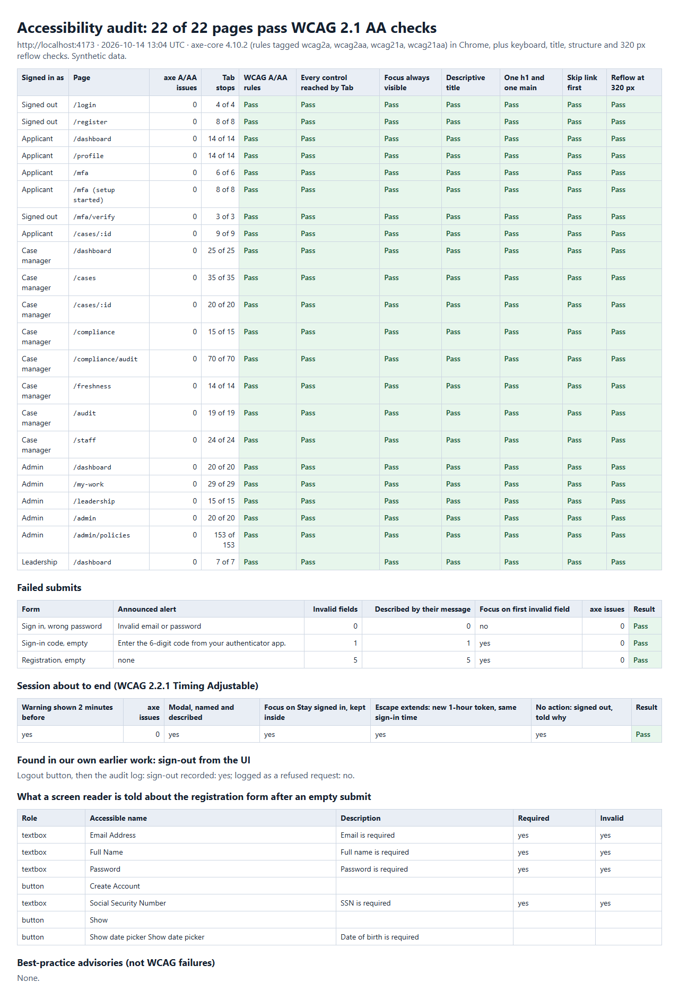
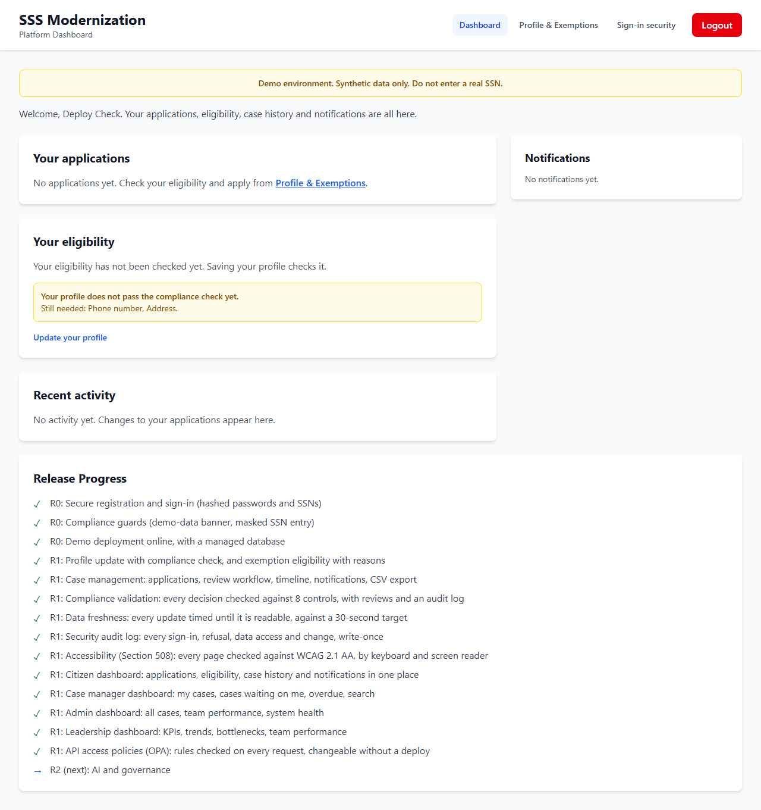
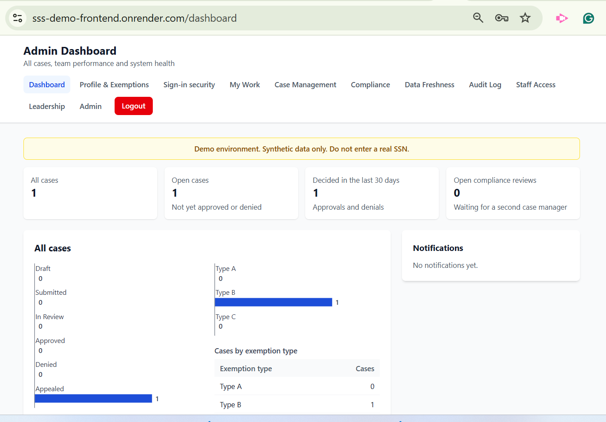

# Milestone: STORY-003, 013, 014, 015 and 016 (R1 complete): shared checks

Five stories in one milestone, all demonstrated on the synthetic demo deployment, not in production: two-step verification at sign-in (STORY-003), the case manager, admin and leadership dashboards with the roles behind them (013 to 015), and API access policies decided by Open Policy Agent (016). With them, R1 is 11 of 11. Each story has its own evidence pack; this one holds the checks they share.

## Checks

- Demo deployment (scripts/verify-deploy.mjs): the API and the site serve a40a63c; all 15 page paths serve the current build; database ok; 19 migrations applied (latest 019_access_policies.sql); 52 routes in the access table (46 before: the sign-in code step, three dashboards and two policy routes); all 28 protected GET routes refuse requests without a token; the audit log records the caller's own address.
- On the demo deployment as a synthetic citizen (scripts/verify-live-citizen.mjs): all 15 staff GET routes refuse it (403), and no staff links show.
- Accessibility, local (scripts/a11y/audit.mjs): 22 of 22 page and role combinations pass WCAG 2.1 AA checks (21 before this milestone's last page; 13 before the milestone), for citizen, case manager, administrator and leadership, plus the form, session-warning and sign-out checks.
- Unit tests: 719 passed in 18 suites (548 before STORY-016, 258 before the milestone). API end to end, local: 351 checks in 9 suites: access 33, workflow 26, compliance 30, freshness 16, audit 30, staff 60, dashboards 66, mfa 67, policy 23.

## Screens

### 1. Every page passes the accessibility audit

22 page and role combinations, including the MFA pages, the three new dashboards and Access Policies, pass the WCAG 2.1 AA checks.

### 2. Demo site: a citizen after the deploy

The deployed demo site, signed in as the synthetic citizen the checks use: no staff links, and the release list shows R1 complete.

### 3. Demo site: the owner as administrator

The owner's own screenshot after listing his case-manager address in ADMIN_EMAILS on Render: his account became the demo's administrator and sees the Admin Dashboard.

## Notes

- All data shown is synthetic.

_Built by `scripts/evidence/report.mjs` from `evidence.json`. Screenshots by `scripts/a11y/audit.mjs (screen 1) on a local copy of the deployed code; scripts/verify-live-citizen.mjs (screen 2) on the demo deployment; the owner's own screenshot of the demo deployment (screen 3)`._
