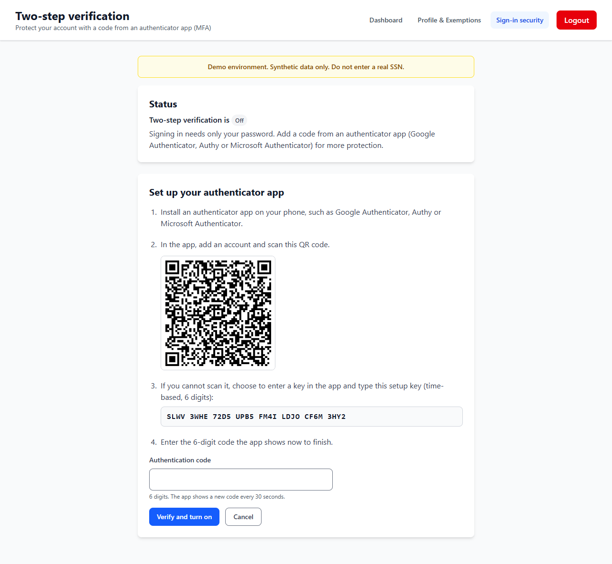
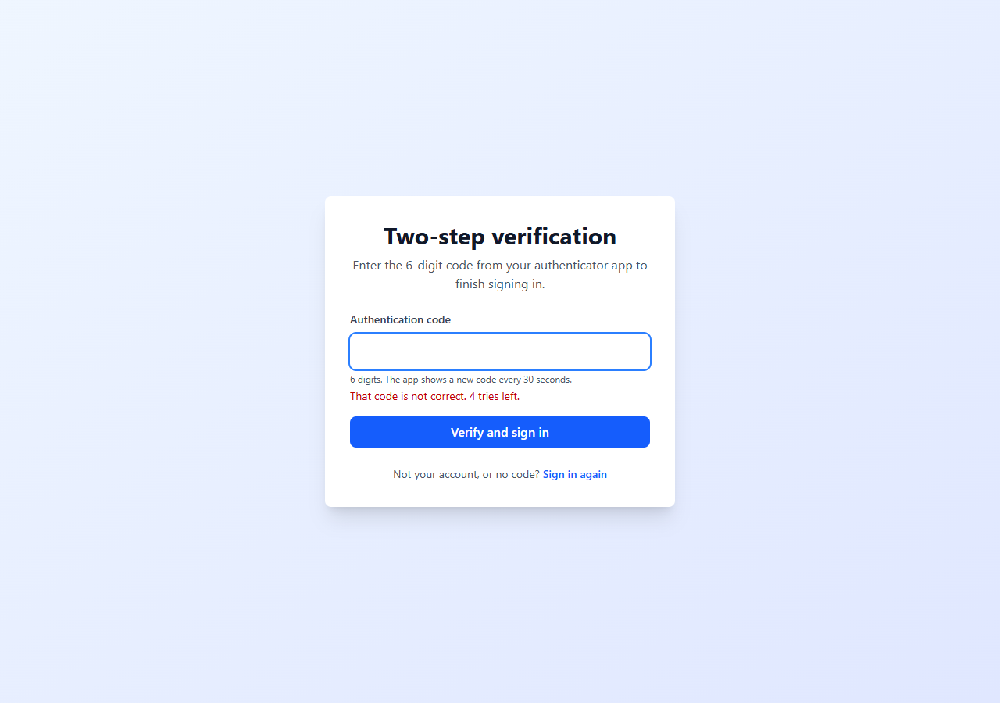
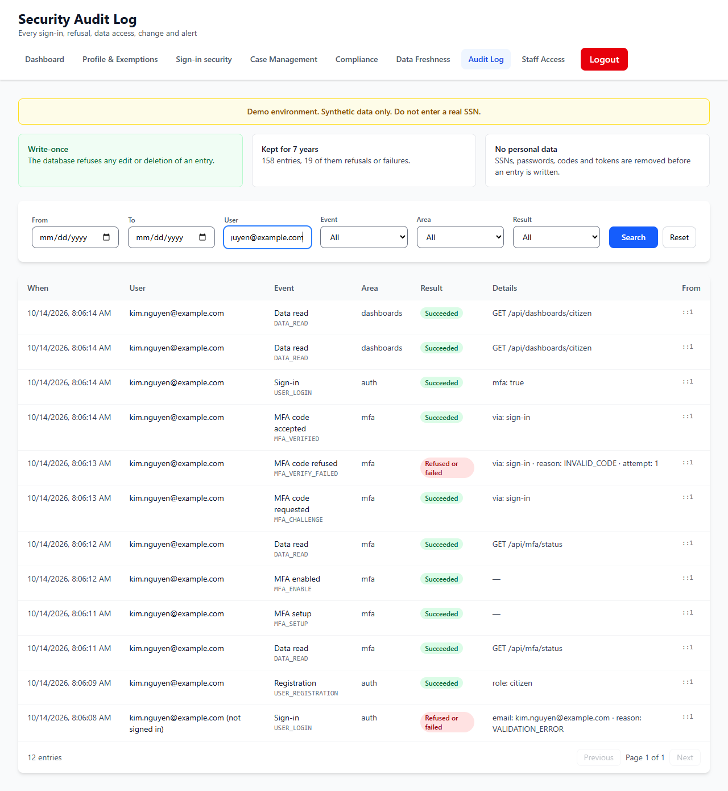

# STORY-003 Two-Step Verification at Sign-in (MFA): evidence

STORY-003 works on the demo deployment, with synthetic data; it is not operating in production. From Profile & Exemptions (Sign-in security) a person turns on two-step verification: the page shows a QR code for an authenticator app (Google Authenticator, Authy or Microsoft Authenticator) and the same key as text, and a 6-digit code from the app turns it on. From then on a correct password is not enough: sign-in asks for a current code.

How the second step is protected. A correct password earns only a 5-minute token marked as an unfinished sign-in; every route and the session refresh refuse it, and it opens nothing but the code check. Codes are RFC 6238 time-based codes, accepted one 30-second step either side of now; a code is never accepted twice; a sign-in allows five tries, each counted before the code is checked, so parallel guesses cannot slip past; turning it off needs a current code. The key is shown once, while setting up, and never returned again.

Found in our own review before it shipped, and fixed: a pending sign-in could be redeemed twice. After the right code, the same 5-minute token accepted the next step's code and gave a second session. A pending sign-in now ends at its first accepted code, decided in one database statement so two requests at once cannot both win, and a replayed token is refused before its code is looked at, so it cannot use up the person's next code. An end-to-end check reproduces the gap and failed on the code as it was.

Every step is in the Security Audit Log (setup, turned on, code requested, code accepted, code refused with the try number and reason, turned off), never the key and never a code.

## Checks

- Evidence run, local (scripts/evidence/story-003-015.mjs): 17 checks passed for this milestone's first four stories, including: the setup page shows a QR code and a 32-character key; the code from the app turns it on; sign-in then asks for the code; a wrong code is refused with '4 tries left'; the right code signs in; the audit trail names every step and never holds the key.
- API end to end, local (scripts/e2e/mfa.mjs): 67 checks passed. Codes are computed in the test the way an authenticator app computes them (RFC 6238 on node:crypto, not the server's library). Covered: the pending token refused by staff routes, the profile and /auth/refresh; the one-step window; five wrong codes end a sign-in; a code works once; a pending sign-in gives one session; the audit trail without keys or codes.
- Unit tests: 39 for the MFA service (the window, the attempt limit, replay, single use, a race on one pending sign-in) and 83 for the MFA and sign-in routes. The two single-use tests were checked by removing the fix: both fail.
- Accessibility (scripts/a11y/audit.mjs): /mfa, /mfa with setup started and /mfa/verify pass the WCAG 2.1 AA checks; the code field is labelled, numeric, autocomplete one-time-code, and its errors are announced with focus on the field.

## Screens

### 1. Setting up an authenticator app

Kim Nguyen starts setup on the Sign-in security page: a QR code for the app, the same key as text for manual entry, and the 6-digit code field that turns two-step verification on.

### 2. Sign-in asks for the code

After the right password, sign-in stops at the second step. A wrong code is refused and counted: 'That code is not correct. 4 tries left.' After five, the person starts again from the password.

### 3. Every step in the audit log

Kim's trail in the Security Audit Log, as a case manager sees it: setup, turned on, code requested, code refused (with the try number and reason) and code accepted. No key and no code is ever written.

## Notes

- Not built yet: recovery codes or a verified reset for someone who loses their phone. On the demo, an account that loses its authenticator needs a database reset; production needs recovery codes or an identity-proofed reset.
- Sign-out still does not end a token early (unchanged since STORY-010); a server-side deny list is on the pre-production list.
- All data shown is synthetic.

_Built by `scripts/evidence/report.mjs` from `evidence.json`. Screenshots by `scripts/evidence/story-003-015.mjs on a local copy of the deployed code`._
