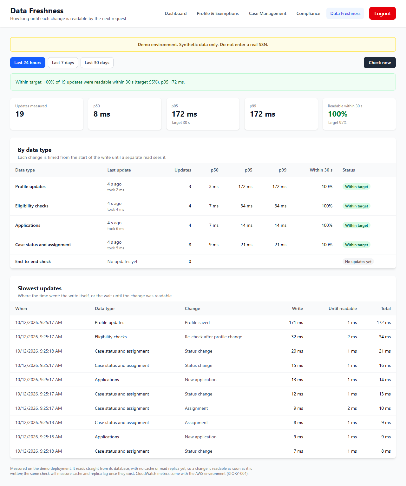
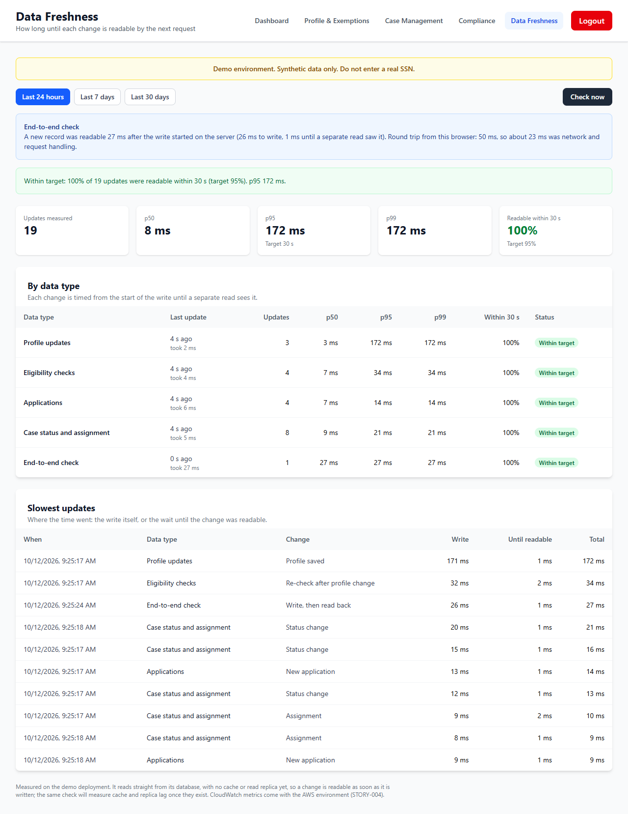
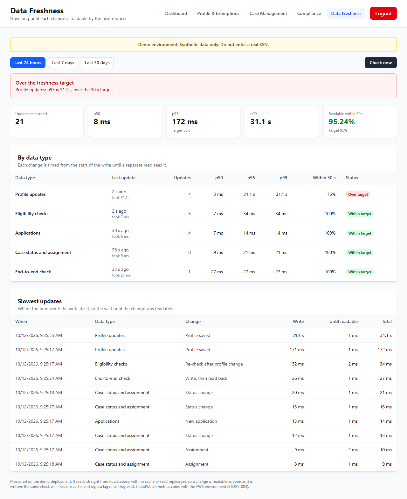
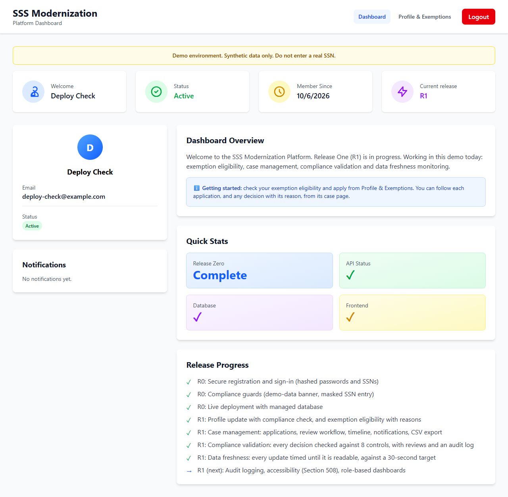
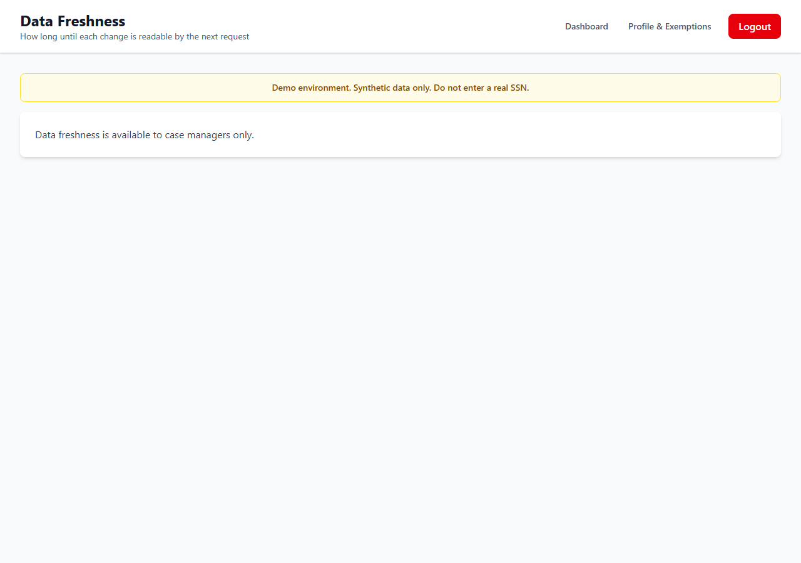

# STORY-009 Data Freshness Monitoring: evidence

STORY-009 works on the demo deployment, with synthetic data; it is not operating in production. Every profile save, eligibility check, application, case status change and assignment is timed from the start of the write until a separate read sees the new row version, the way the next request would. Staff get a Data Freshness page with p50, p95 and p99 per data type against a 30-second target for 95% of updates, an alert when a type falls behind, the slowest updates split into write time and wait time, and a Check now button that times a write end to end from the browser.

Screens 1 to 3 come from an automated run against a local copy of the deployed code, seeded through the API, because the demo site has no test case-manager accounts. Screen 3 follows a real slowdown: the run held one applicant's database row locked for 31 seconds while that applicant saved a profile. Screens 4 and 5 are the deployed demo site.

## Checks

- Demo deployment (scripts/verify-deploy.mjs): the API and the site serve 36a98bd; all 8 page paths serve the current build; database ok; 14 migrations applied; all 22 protected GET routes answer 401 without a token.
- On the demo deployment, signed in as a synthetic citizen (scripts/verify-live-citizen.mjs): all 13 staff GET routes answer 403, no staff links show, and the freshness page refuses the citizen.
- UI run (scripts/evidence/story-009.mjs): 8 checks passed, including the alert after the 31-second slowdown.
- API end to end, local (scripts/e2e): 105 checks passed: access 33, case workflow 26, compliance 30, freshness 16.
- Unit tests: 150 passed, including 12 new freshness tests and 117 route-access checks across all 40 routes.

## Screens

### 1. On target

Sam Ortiz, a case manager, opens Data Freshness after ordinary activity: 19 updates across four data types, all readable within 30 seconds, p95 172 ms. Each type shows when it last changed and how long its changes take.

### 2. Check now, end to end

Check now writes a record and times how long until a separate read sees it: readable 27 ms after the write began on the server. The browser's round trip was 50 ms, so about 23 ms was network and request handling.

### 3. A real slowdown raises the alert

One applicant's database row was held locked for 31 seconds while that applicant saved a profile. Profile updates' p95 rose to 31.1 s, over the 30 s target, and the page raised the alert; the slowest-updates list shows the time went into the write, not the wait to read. Every other data type stayed in milliseconds.

### 4. Demo site: a citizen's dashboard

The deployed demo site lists data freshness as done in the release progress, and a citizen sees no staff links.

### 5. Demo site: a citizen opening /freshness

The page refuses, and the demo site's API answers 403 to a citizen on all 13 staff routes.

## Notes

- Measured on the demo deployment, which reads straight from its database with no cache or read replica yet, so a change is readable as soon as it is written. The same check, reading the row version on a separate request, will measure cache or replica lag when those arrive with AWS.
- CloudWatch metrics, named in the story's acceptance criteria, need the AWS environment (STORY-004, waiting on approval). Until then the same figures come from the demo's own measurements. Cache miss rate does not apply yet because the demo has no cache.
- Removed in this story: the /api/data and /api/latency placeholder endpoints. One reported data as fresh without measuring anything; another, a staff-only cleanup endpoint, put a request value straight into SQL. The route table now holds 40 routes.
- After a deploy, the site's CDN can serve the previous page for a deep link for up to 5 minutes. verify-deploy now waits until all page paths serve the current build before reporting a deploy as verified.
- All data shown is synthetic.

_Built by `scripts/evidence/report.mjs` from `evidence.json`. Screenshots by `scripts/evidence/story-009.mjs (screens 1-3) and scripts/verify-live-citizen.mjs (screens 4-5)`._
