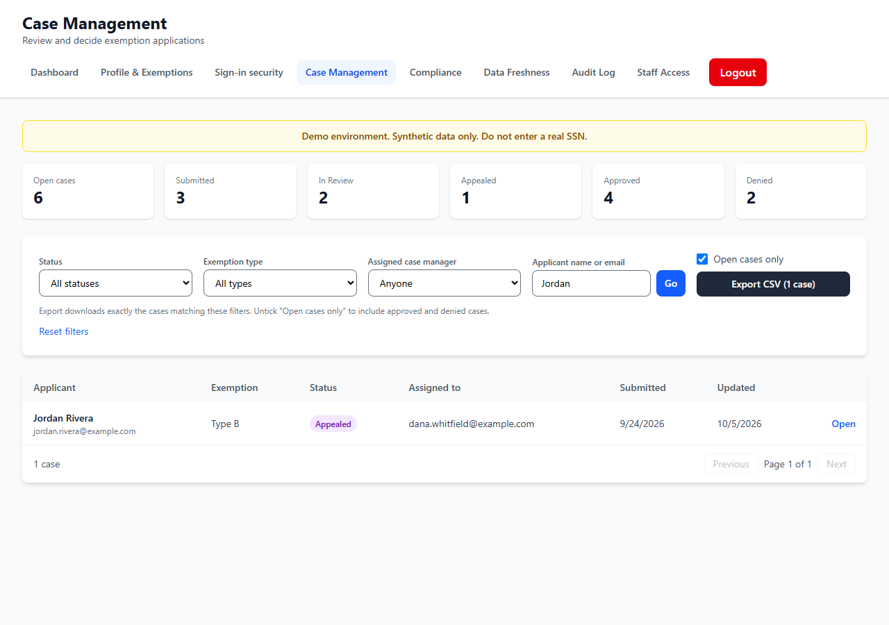

# STORY-013 Case Manager Dashboard: evidence

STORY-013 works on the demo deployment, with synthetic data; it is not operating in production. A case manager's dashboard (also at My Work) is their work list: the cases assigned to them and not yet decided, with the days since the last update; what is waiting on them (submitted cases to start, cases to decide, and compliance reviews of other managers' decisions they may resolve); the unassigned queue, oldest first; everything open, theirs or unassigned, with no update for more than 5 days, marked overdue; their recent decisions; and a search that opens the case list filtered.

The case list now reads its filters from the address, so a search from the dashboard can be bookmarked or shared.

## Checks

- Evidence run, local (scripts/evidence/story-003-015.mjs, 17 checks passed): Dana sees her overdue case and the overdue unassigned one, and Sam's decision on Quinn's case waiting for her compliance review; the search opens /cases?applicant=Jordan.
- API end to end, local (scripts/e2e/dashboards.mjs, 66 checks for STORY-013 to 015): who may read each dashboard (citizen, case manager, leadership, admin); the numbers move as cases are created, assigned, reviewed and decided; the overdue and stuck rules after moving a case's dates back.
- Unit tests for the three dashboards' figures (the overdue threshold, approval rate with no decisions, week buckets, no personal data in the leadership output).
- Accessibility: the case manager's /dashboard and an admin's /my-work pass the WCAG 2.1 AA checks.

## Screens

### 1. Dana's work list

Waiting on her: a submitted case to start, three to decide, and one compliance review of Sam's decision (Quinn's case was approved without the required document). Below: overdue cases, her open cases, the unassigned queue and her recent decisions, with a search form at the side.

### 2. Search opens the case list

Searching for 'Jordan' from the dashboard opens Case Management filtered by that applicant; the filters are in the address.

## Notes

- Overdue means no update for more than 5 days, as the story's specification sets it.
- The evidence run laid the case timelines out over the past weeks (moving dates back in the database), so the figures show weeks of history.
- All data shown is synthetic.

_Built by `scripts/evidence/report.mjs` from `evidence.json`. Screenshots by `scripts/evidence/story-003-015.mjs on a local copy of the deployed code`._
