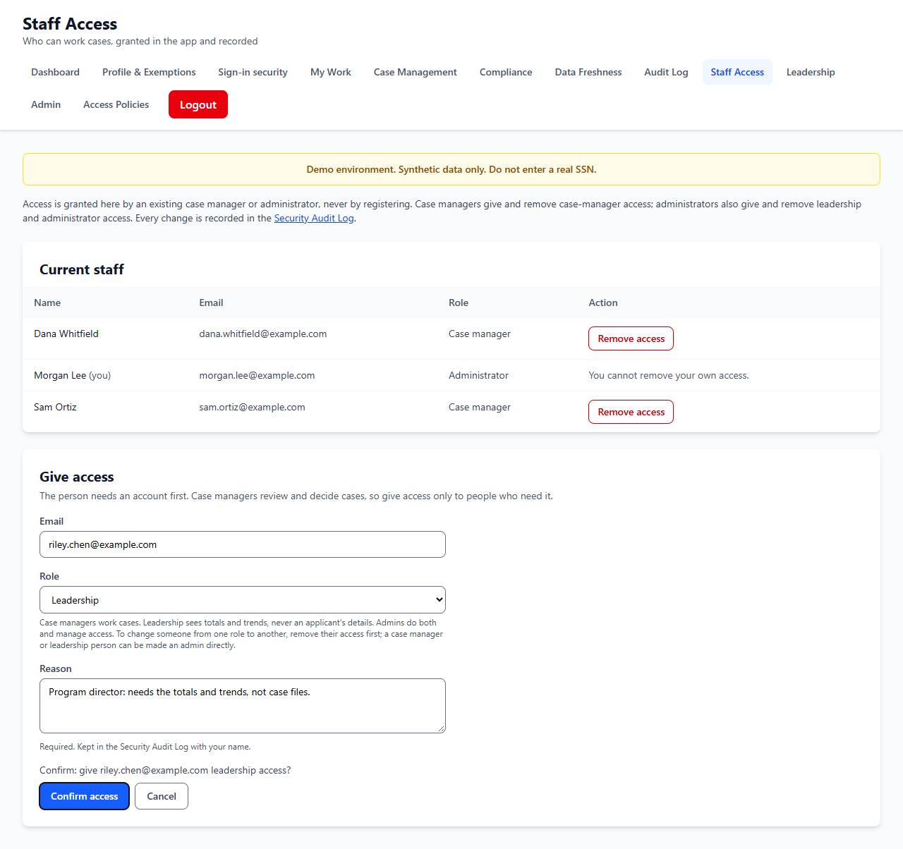

# STORY-014 Admin Dashboard, with administrator and leadership roles: evidence

STORY-014 works on the demo deployment, with synthetic data; it is not operating in production. An administrator's dashboard shows all cases (by status and by exemption type, as charts each followed by a table with the same numbers), open cases, decisions in the last 30 days and open compliance reviews; team performance per case manager (open cases, decisions, median days to decide, compliance pass rate); and system health (database and migrations, the deployed commit, data freshness against its 30 s target, compliance against its 99% target, access refusals in the last 24 hours, staff by role), each linked to its page.

Roles: citizen, case manager, leadership and administrator. In Staff Access an administrator gives and removes case-manager, leadership and administrator access; a case manager still gives only case-manager access and is refused the others. Never your own access, never the last case manager, never the last administrator. The first administrator comes from ADMIN_EMAILS, and only from people who already are case managers, so registering a listed address grants nothing.

## Checks

- Evidence run, local: the admin dashboard shows all cases, the team and system health; Morgan gives Riley leadership access with a reason; Riley then holds the leadership role.
- API end to end, local (scripts/e2e/staff.mjs, 60 checks): an administrator gives leadership and administrator access; a case manager is refused both (403); the last administrator cannot be removed; every change is audited with who, why and the role.
- Demo deployment: after the owner listed his case-manager address in ADMIN_EMAILS on Render, his account became the demo's administrator (screenshot in the milestone pack).

## Screens

### 1. Morgan's admin dashboard

All 12 cases by status and type, team performance for Dana and Sam, and system health. Compliance shows 'Below target' because one decision in the run was made without the required document, which opened a second-manager review.

### 2. Giving leadership access

As an administrator, Morgan chooses the role (Leadership) on Staff Access, gives the reason, and confirms in place.

## Notes

- A person given a role must sign in again to see its pages; the API applies the change at once, and the notification says so.
- All data shown is synthetic.

_Built by `scripts/evidence/report.mjs` from `evidence.json`. Screenshots by `scripts/evidence/story-003-015.mjs on a local copy of the deployed code`._
